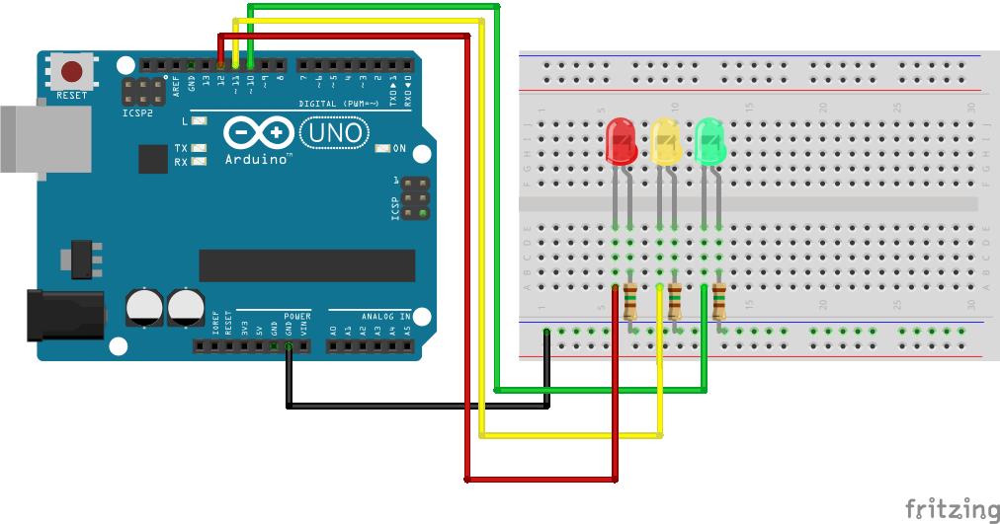
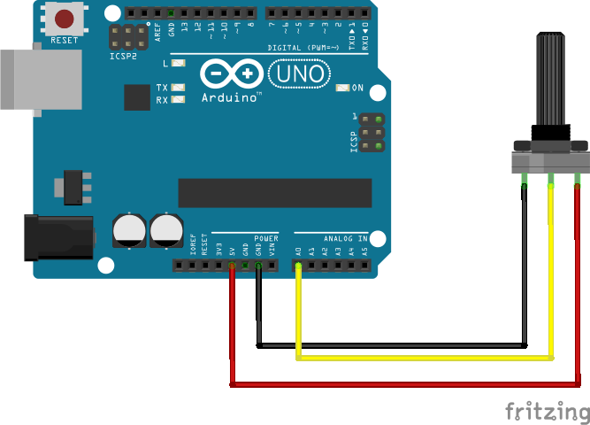
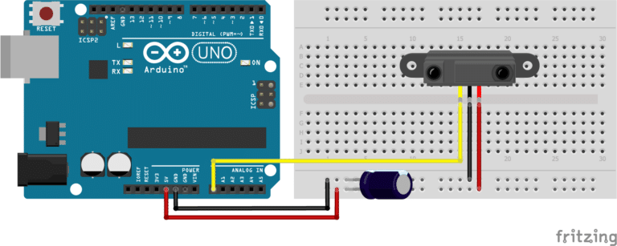
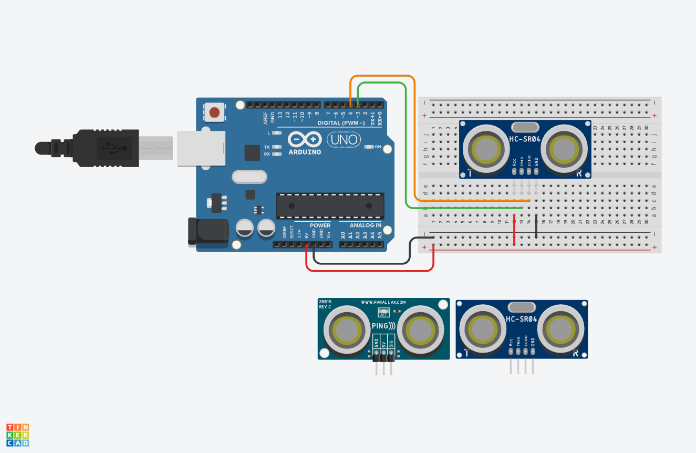

# Clase 4 · Laboratorio de interacción y protocolos de comunicación 🔌🎵

> **Objetivo de la clase:** Integrar circuitos, sensores y programación en ejercicios de interacción, mediante la selección de vías de comunicación adecuadas para cada proyecto.

---

## 🎯 Resultados de aprendizaje

Al finalizar la clase, las y los estudiantes podrán:

1. **Aplicar** la Ley de Ohm y el mapeo de datos en circuitos interactivos.
2. **Implementar** lecturas de proximidad y distancia con respuestas visuales o sonoras.
3. **Distinguir** UART, SPI, I²C y OSC según su función, conexión y contexto de uso.

---

# 📦 Materiales

Los montajes se preparan por estación. Los grupos rotan y llevan sus decisiones de diseño a sus propios proyectos.

| Estación | Materiales | Placa prevista |
|---|---|---|
| 1 · LED y Ohm | 3 LEDs (rojo, verde, amarillo), resistencias de 150 Ω, protoboard, cables; multímetro opcional | UNO R3/R4 o Leonardo/Micro de 5 V |
| 2 · MAP y UART | 1 placas, 1 potenciómetro de 10 kΩ, cables | UNO R3, UNO R4, Leonardo o Micro; todas a lógica de 5 V |
| 3 · Proximidad y MIDI | SHARP analógico, cableado, computador con Sonic Pi, audífonos | Leonardo/Micro/Pro Micro ATmega32u4/ Zero |
| 4 · Ultrasonido | HC-SR04 convencional de 5 V, regla o cinta métrica y superficie plana | UNO R3/R4 o Leonardo/Micro de 5 V |

**Software:** Arduino IDE, core de cada placa y Sonic Pi de escritorio. `Wire`, `SPI` y `SoftwareSerial` para UNO R3 se distribuyen con sus cores; instalar `MIDIUSB` para la estación MIDI. No cargar todos los sketches juntos: abrir únicamente la carpeta del ejercicio elegido.

> [!IMPORTANT]
> Desconectar la alimentación antes de recablear. Una resistencia por LED. Compartir GND entre dispositivos conectados por señales eléctricas. No conectar una señal de 5 V directamente a una entrada ESP32/ESP8266. Los pines y tensiones de esta guía están asociados a placas concretas.

---

# 1. 🔄 Organización de las estaciones

Formar cuatro grupos. En cada estación distribuir los roles de montaje, programación, comprobación y registro; rotar también los roles.

| Ronda | Grupo A | Grupo B | Grupo C | Grupo D |
|---|---|---|---|---|
| 1 | Estación 1 | Estación 2 | Estación 3 | Estación 4 |
| 2 | Estación 2 | Estación 3 | Estación 4 | Estación 1 |
| 3 | Estación 3 | Estación 4 | Estación 1 | Estación 2 |
| 4 | Estación 4 | Estación 1 | Estación 2 | Estación 3 |

Cada ronda: 3 minutos para reconocer el circuito, 10 para ejecutar, 5 para modificar y 2 para registrar. Dejar el montaje base operativo para el grupo siguiente.

**Registro común:** qué entra, qué se transforma, qué sale, qué evidencia confirma el funcionamiento y cómo podría incorporarse al proyecto del grupo.

---

# 2. 🚦 Estación 1 · LEDs y Ley de Ohm

## Propósito

Retomar el semáforo de la clase 1 y relacionar resistencia, corriente y respuesta luminosa.

## Antes del código

Para un LED debemos considerar su caída de tensión:

**R = (V de alimentación − V del LED) / I deseada**

Ejemplo aproximado: salida de 5 V, LED rojo de 2 V y corriente deseada de 5 mA:

**R = (5 − 2) / 0,005 = 600 Ω**. Un valor comercial de 680 Ω entrega aproximadamente 4,4 mA.

Para comparar con el mismo LED rojo: 150 Ω entrega aproximadamente 6,4 mA; 1 kΩ, 3 mA. Son estimaciones: la caída del LED y la salida real varían. No asumir que todos los colores tienen la misma caída ni comparar brillo como si fuera un amperímetro.

## Cableado



| Salida | Componente | Retorno |
|---|---|---|
| D10 | Resistencia de 150 Ω + ánodo de LED verde | Cátodo a GND |
| D11 | Resistencia de 150 Ω + ánodo de LED amarillo | Cátodo a GND |
| D12 | Resistencia de 150 Ω + ánodo de LED rojo | Cátodo a GND |

La resistencia puede colocarse antes o después del LED, siempre en serie. Estos números de pin corresponden a este ejercicio: adaptar si se reutiliza otro cableado.

## Código base

Archivo: [01_leds_ohm.ino](arduino/01_leds_ohm/01_leds_ohm.ino)

```cpp
// UNO R3/R4, Una resistencia por LED.
const int VERDE = 10;
const int AMARILLO = 11;
const int ROJO = 12;

void estado(bool v, bool a, bool r) {
  digitalWrite(VERDE, v ? HIGH : LOW);
  digitalWrite(AMARILLO, a ? HIGH : LOW);
  digitalWrite(ROJO, r ? HIGH : LOW);
}

void setup() {
  pinMode(VERDE, OUTPUT);
  pinMode(AMARILLO, OUTPUT);
  pinMode(ROJO, OUTPUT);
}

void loop() {
  estado(true, false, false);
  delay(3000);
  estado(false, true, false);
  delay(1000);
  estado(false, false, true);
  delay(3000);
}
```

---

# 3. 📊 Estación 2 · `map()`, `Serial.print()` y UART

## Propósito

Leer una entrada, transformar su rango y enviar el resultado por monitor serial.

`map(lectura, 0, 1023, 0, 127)` transforma linealmente un entero. `constrain()` limita el intervalo. Ninguna de las dos instrucciones convierte por sí sola una lectura en centímetros.

| ADC de entrada | Resultado aproximado |
|---:|---:|
| 0 | 0 |
| 512 | 63 |
| 1023 | 127 |

El cálculo entero trunca decimales. Usar un rango 0–127 **no convierte estos datos en mensajes MIDI**.



## Cableado

Potenciómetro: extremos a 5 V y GND del emisor; terminal central a A0. Ambas placas se alimentan por sus propios cables USB; unir GND, sin unir sus pines de 5 V.


## Código del emisor

```cpp
void setup() {
  Serial.begin(9600);
}

void loop() {
  int lectura = analogRead(A0);
  int valor = map(lectura, 0, 1023, 0, 127);

  Serial.println(valor);

  delay(100);
}
```

---

# 4. 🎹 Estación 3 · Proximidad y MIDI con Sonic Pi



## Propósito

Controlar la altura de notas mediante un sensor de distancia analógico. El flujo es: lectura ADC → mapeo → mensaje USB-MIDI → síntesis en Sonic Pi.

## Montaje y calibración

Para Leonardo/Micro de 5 V: SHARP VCC a 5 V, GND a GND y Vo a A0, verificando el pinout del sensor. GP2Y0A21YK0F: rango nominal 10–80 cm; GP2Y0A02YK0F: 20–150 cm. Consultar su ficha para alimentación y desacoplo.

Primero usar el emisor de la estación 2 sin conectar la UART externa para observar la lectura en el monitor. Registrar mínimo y máximo del gesto dentro del rango útil; copiarlos a `ADC_MIN` y `ADC_MAX` del sketch MIDI. El máximo debe ser mayor que el mínimo. La relación SHARP voltaje–distancia es no lineal: aquí controlamos notas, no calculamos centímetros.

## Código MIDI · Zero

```cpp
#include <MIDIUSB.h>
const int SENSOR = A0;
const int ADC_MIN = 0;     // Reemplazar por la calibración medida.
const int ADC_MAX = 1023;  // Siempre mayor que ADC_MIN.

void enviar(byte nota, bool activar) {
  midiEventPacket_t paquete = {
    (byte)(activar ? 0x09 : 0x08),
    (byte)(activar ? 0x90 : 0x80),  // Canal MIDI 1.
    nota,
    (byte)(activar ? 80 : 0)
  };
  MidiUSB.sendMIDI(paquete);
  MidiUSB.flush();
}

void setup() {
  pinMode(SENSOR, INPUT);
}

void loop() {
  int lectura = constrain(analogRead(SENSOR), ADC_MIN, ADC_MAX);
  byte nota = (byte)map(lectura, ADC_MIN, ADC_MAX, 48, 84);
  enviar(nota, true);
  delay(100);
  enviar(nota, false);
  delay(150);
}
```

Instalar `MIDIUSB`. El ejercicio genera notas repetidas cada 250 ms; la distancia modifica su altura. Cada activación tiene su correspondiente desactivación.

## Receptor de Sonic Pi

```ruby
# Ejecutar en Sonic Pi de escritorio.
live_loop :proximidad_midi do
  use_real_time
  nota, velocidad = sync "/midi*/note_on"
  if velocidad > 0
    synth :piano, note: nota, amp: velocidad / 127.0, release: 0.25
  end
end
```

---

# 5. 📏 Estación 4 · Ultrasonido y distancia

## Propósito

Medir distancia mediante tiempo de vuelo con un HC-SR04 convencional de 5 V.

El pin **TRIG** recibe un pulso de al menos 10 µs. El ancho del pulso **ECHO** representa el tiempo de ida y vuelta. A temperatura ambiente podemos aproximar:

**Distancia en cm = tiempo en µs × 0,0343 / 2**

Dividimos por dos porque el sonido va hasta el objeto y vuelve. La velocidad depende de las condiciones del aire; la fórmula no implica precisión absoluta.



## Cableado para placas de 5 V

| HC-SR04 | UNO R3/R4 |
|---|---|
| VCC | 5 V |
| GND | GND |
| TRIG | D7 |
| ECHO | D6 |

## Código

```cpp
// HC-SR04 convencional de 5 V + UNO R3/R4.
const int TRIG = 7;
const int ECHO = 6;
const unsigned long TIMEOUT_US = 30000UL;

void setup() {
  Serial.begin(115200);
  pinMode(TRIG, OUTPUT);
  pinMode(ECHO, INPUT);
  digitalWrite(TRIG, LOW);
}

void loop() {
  digitalWrite(TRIG, LOW);
  delayMicroseconds(2);
  digitalWrite(TRIG, HIGH);
  delayMicroseconds(10);
  digitalWrite(TRIG, LOW);

  unsigned long tiempo = pulseIn(ECHO, HIGH, TIMEOUT_US);
  if (tiempo == 0) {
    Serial.println("SIN_ECO");
  } else {
    float distancia = tiempo * 0.0343f / 2.0f;
    if (distancia < 2.0f || distancia > 400.0f) {
      Serial.println("FUERA_DE_RANGO");
    } else {
      Serial.print("DISTANCIA_CM=");
      Serial.println(distancia, 1);
    }
  }
  delay(70);  // Separar disparos para evitar ecos de la medición previa.
}
```

`pulseIn()` mide la duración del pulso y retorna 0 al agotarse el tiempo de espera. **Ausencia de eco no significa distancia cero**. Este ejemplo usa una espera acotada de 30 ms y separa los disparos; sigue siendo un código bloqueante, suficiente para esta estación.

---

# 6. 🔌 Bloque 2 · ¿Qué necesitamos comunicar?

UART, I²C y SPI resuelven conexiones seriales entre componentes o dispositivos. OSC organiza mensajes de aplicación y, en esta clase, viaja por UDP/IP. Por eso no se comparan como si fueran cuatro conectores equivalentes.

La clase 4 de 2025 sirve como base para esta síntesis. Se precisan tres puntos: los cables de señal no incluyen GND/alimentación; I²C admite múltiples controladores aunque aquí usemos uno; OSC pertenece a otra capa de comunicación.

| Tecnología | Reloj compartido | Señales habituales, sin alimentación/GND | Selección del destino | Uso típico |
|---|---|---|---|---|
| UART | No | TX, RX; un sentido puede usar solo TX→RX | Enlace físico | Dos placas o módulo serial |
| I²C | Sí, SCL | SDA, SCL | Dirección de dispositivo | Varios sensores en un bus |
| SPI | Sí, SCK | COPI, CIPO, SCK y CS por periférico en el montaje habitual | Línea CS | Pantallas, memorias, tarjetas SD |
| OSC sobre UDP/IP | No hay reloj de bus compartido | Depende de Ethernet/Wi-Fi | IP + puerto; dirección OSC identifica la acción | Software audiovisual y control por red |

**Para elegir:** comprobar distancia de conexión, volumen de datos, latencia requerida, cantidad de dispositivos y soporte real del componente. No hay una velocidad universal propia de cada nombre.

---

# 7. 🔁 UART · Retomar la estación 2

UART transmite sin reloj compartido: ambos extremos acuerdan velocidad y formato. **8N1** significa 8 bits de datos, sin paridad y 1 bit de parada; se agrega un bit de inicio por carácter.

A 9600 bit/s, una trama 8N1 utiliza 10 bits por carácter: el máximo teórico es aproximadamente 960 caracteres/s, antes de pausas del programa. `println(127)` envía caracteres de texto y fin de línea; no un único byte con valor 127.

## Demostración breve

Reutilizar el emisor/receptor de la estación 2. Identificar físicamente TX, RX y GND, luego seguir un número desde A0 hasta el monitor del receptor.

**Límites:** los niveles UART del microcontrolador no son niveles RS-232. No conectar un puerto RS-232 directamente. El enlace UART lógico no define por sí mismo cómo separar y validar mensajes: aquí acordamos una línea por valor.

---

# 8. 🧭 I²C · Varios dispositivos en dos señales

I²C utiliza **SDA** para datos y **SCL** para reloj. Los dispositivos responden a direcciones; dos con igual dirección pueden necesitar configuración, otro bus o multiplexor.

Las líneas requieren resistencias **pull-up** a una tensión compatible. Algunos módulos ya las incluyen; no sumar resistencias sin revisar el circuito. Una alimentación compatible no garantiza que las líneas del módulo tengan adaptación de nivel.

La especificación admite múltiples controladores con arbitraje. Para esta clase trabajamos con **un controlador Arduino y uno o varios periféricos**.

## Demostración · Escáner de direcciones

```cpp
// UNO R3/R4: A4 SDA, A5 SCL.
#include <Wire.h>

void setup() {
  Serial.begin(115200);
  Wire.begin();
  Wire.setClock(100000);
}

void loop() {
  byte encontrados = 0;
  Serial.println("Explorando I2C...");
  for (byte direccion = 0x08; direccion <= 0x77; direccion++) {
    Wire.beginTransmission(direccion);
    byte resultado = Wire.endTransmission();
    if (resultado == 0) {
      Serial.print("ACK en 0x");
      if (direccion < 16) Serial.print('0');
      Serial.println(direccion, HEX);
      encontrados++;
    }
  }
  Serial.print("Dispositivos que responden: ");
  Serial.println(encontrados);
  delay(3000);
}
```

Abrir a 115200. Registrar las direcciones que responden. Un ACK confirma respuesta en esa dirección, **no identifica con certeza el modelo ni entrega todavía una medición**. Para leer registros necesitamos la ficha o biblioteca del sensor.

**Pregunta:** ¿qué ocurre si dos módulos comparten dirección y no permiten cambiarla?

---

# 9. ⚡ SPI · Reloj y selección por periférico

En SPI habitual el controlador genera **SCK**. **COPI/MOSI** lleva datos del controlador al periférico y **CIPO/MISO** lleva el retorno. **CS/SS** selecciona el periférico, habitualmente en nivel bajo.

Los dispositivos deben coincidir en frecuencia admisible, orden de bits y modo SPI —polaridad/fase del reloj—. No basta con conectar cuatro cables. En un bus compartido, los periféricos no seleccionados deben liberar la línea de retorno.

## Demostración · Retorno local de un byte

Para observar `SPI.transfer()` sin introducir un módulo adicional, usar una **UNO R3/R4 sin periféricos conectados**. Unir D11/COPI con D12/CIPO. D10 representa CS y D13 es SCK, pero no necesitan cables externos en esta prueba.

```cpp
// Prueba en UNO R3/R4 SIN periféricos conectados.
// Unir D11 (COPI/MOSI) con D12 (CIPO/MISO).
#include <SPI.h>
const int CS = 10;
byte contador = 0;

void setup() {
  Serial.begin(115200);
  pinMode(CS, OUTPUT);
  digitalWrite(CS, HIGH);
  SPI.begin();
}

void loop() {
  SPI.beginTransaction(SPISettings(1000000, MSBFIRST, SPI_MODE0));
  digitalWrite(CS, LOW);
  byte recibido = SPI.transfer(contador);
  digitalWrite(CS, HIGH);
  SPI.endTransaction();

  Serial.print("TX=");
  Serial.print(contador);
  Serial.print(" RX=");
  Serial.print(recibido);
  Serial.println(recibido == contador ? " OK" : " REVISAR PUENTE");
  contador++;
  delay(500);
}
```

Se espera `TX` igual a `RX` al recorrer distintos valores. Quitar el puente produce un resultado indeterminado: no asumir que siempre será cero.

> Esta prueba comprueba transmisión y recepción local. No simula los registros, respuestas ni requisitos de un sensor SPI. Para un periférico real, retirar el puente y usar su biblioteca y cableado.

**Pregunta:** ¿por qué una pantalla y una tarjeta SD pueden compartir reloj y datos, pero necesitan selección independiente en un montaje convencional?

---

# 10. 🌐 OSC · Mensajes para interacción audiovisual

**Open Sound Control** permite organizar mensajes mediante direcciones y argumentos tipados. En este ejercicio:

| Elemento | Ejemplo | Función |
|---|---|---|
| IP | `192.168.1.100` | Computador de destino |
| Puerto UDP | `4560` | Entrada OSC de Sonic Pi |
| Dirección OSC | `/clase4/nota` | Acción o dato acordado |
| Argumentos | `60`, `80` | Nota e intensidad |

La dirección OSC no es una URL web. No es obligatorio que un argumento represente notas: puede representar distancia, temperatura, posición o una decisión de interacción.

OSC no transporta audio por el hecho de controlar sonido. UDP no garantiza entrega, orden ni retransmisión; aplicaciones que requieran confirmaciones deben diseñarlas.

## Demostración A · OSC en un mismo computador

En Sonic Pi activar recepción OSC en preferencias y verificar el puerto **4560**. Primero ejecutar este receptor:

```ruby
# Ejecutar antes que el emisor.
live_loop :receptor_clase4 do
  use_real_time
  nota, velocidad = sync "/osc*/clase4/nota"
  if nota >= 0 && nota <= 127 && velocidad > 0 && velocidad <= 127
    synth :pulse, note: nota, amp: velocidad / 127.0, release: 0.2
  end
end
```

Luego ejecutar en otro buffer:

```ruby
# Ejecutar en otro buffer, con el receptor ya activo.
use_osc "127.0.0.1", 4560
use_bpm 120
live_loop :emisor_clase4 do
  [60, 64, 67, 72].each do |nota|
    osc "/clase4/nota", nota, 80
    sleep 1
  end
end
```

Observar Cues. `127.0.0.1` refiere al mismo computador. Esta prueba permite comprobar mensaje y recepción sin depender de Wi-Fi. Detener el emisor local antes de probar la ESP32 para no mezclar eventos.

---

# 11. 🧠 Elegir para el proyecto

| Necesidad | Punto de partida | Qué verificar |
|---|---|---|
| Unir dos placas próximas | UART | TX/RX, GND, tensión, velocidad y formato |
| Agregar varios sensores de bajo caudal | I²C | Direcciones, pull-ups, niveles y longitud del bus |
| Controlar pantalla o memoria con transferencias rápidas | SPI | CS, modo, frecuencia y biblioteca |
| Controlar Sonic Pi desde una placa USB compatible | USB-MIDI | USB nativo, core y mensajes |
| Comunicar datos con varios programas o por Wi-Fi | OSC | IP, puerto, dirección, tipos y recepción de red |

No todos los sensores usan estos buses: SHARP entrega voltaje analógico y HC-SR04 usa TRIG/ECHO. La placa puede convertir esas lecturas y enviarlas después por UART, MIDI u OSC.

---

# 12. 🔍 Solución de problemas

| Síntoma | Comprobación |
|---|---|
| LED apagado | Polaridad, resistencia, GND y pin del sketch |
| UART sin datos | TX→RX, tierra común, pines según placa, velocidad 9600 |
| UART muestra caracteres extraños | Baudios y formato; distinguir monitor USB de enlace externo |
| MAP no alcanza extremos | Lecturas reales, calibración y resolución ADC |
| MIDI no aparece | Placa USB compatible, conector nativo y biblioteca |
| MIDI aparece pero no suena | Ruta Cues, velocidad, salida de audio y volumen |
| Ultrasonido entrega SIN_ECO | Alimentación, TRIG/ECHO, superficie y distancia |
| I²C no encuentra dispositivos | Cableado, tensión, pull-ups, bus seleccionado y dirección |
| SPI no devuelve lo enviado | Puente D11–D12 en UNO; retirar periféricos |
| OSC local funciona pero por red no | IP LAN, puerto, permiso de red, firewall y aislamiento de clientes |

---
